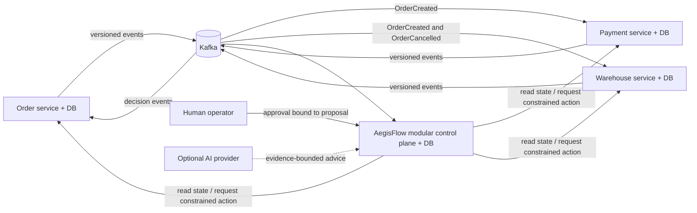

# AegisFlow

> **Status:** Phase 0 documentation baseline. There is no application code, deployable service, database migration, or measured runtime result yet.

AegisFlow is a learning-oriented, production-minded portfolio project for detecting and safely recovering inconsistent distributed business transactions. The first scenario uses independently persisted Order, Payment, and Warehouse simulators. A control plane will correlate their events, detect breached business invariants, assemble attributable evidence, propose a constrained recovery, require deterministic policy and human approval where appropriate, invoke only versioned service APIs, and verify the result against authoritative service state.

AegisFlow is **not** represented as enterprise-ready software. It is a deliberately bounded system in which failure semantics, security boundaries, tests, and resumable documentation are treated as first-class deliverables.

## The problem in one example

An order is accepted and payment succeeds, but the warehouse times out. A timeout does not reveal whether the reservation failed or succeeded. Retrying blindly can duplicate a side effect; refunding blindly can create a different inconsistency. AegisFlow records the ambiguity, queries the warehouse's authoritative API, applies policy and approval rules to an exact recovery proposal, uses an idempotency key and state precondition when acting, and independently checks the final state before calling the incident resolved.

## Scope and safety boundary

The MVP across product stages P0–P2 is intended to demonstrate:

- at-least-once Kafka event delivery with database-enforced inbox idempotency;
- explicit handling of duplicates, reordering, schema incompatibility, missing events, and ambiguous remote outcomes;
- durable incident, evidence, approval, action-attempt, and verification records;
- tenant-scoped authorization and data access;
- a deterministic investigator before an optional evidence-backed AI investigator;
- recovery through versioned APIs with scoped credentials—never direct writes to simulator databases; and
- a fault-injected, testable vertical slice with honest observed results.

Out of scope for the first implementation are real money movement, real customer data, autonomous financial compensation, a general-purpose workflow engine, Kubernetes, and claims of universal exactly-once effects.

## Proposed system shape

The control plane is planned as one modular Spring Boot deployment. The three simulators remain independent deployments and each owns a separate PostgreSQL database. See [System Architecture](docs/architecture/SYSTEM_ARCHITECTURE.md) for trust boundaries and flows.

## Documentation map

| Start here | Purpose |
|---|---|
| [Product requirements](docs/requirements/PRD.md) | users, scope, workflow, requirements, acceptance tests, competitor-aware position |
| [System architecture](docs/architecture/SYSTEM_ARCHITECTURE.md) | containers, modules, trust boundaries, end-to-end flows |
| [Data model](docs/architecture/DATA_MODEL.md) | ownership, durable records, constraints, tenant keys |
| [Event contracts](docs/architecture/EVENT_CONTRACTS.md) | envelope, schemas, ordering, compatibility, topics |
| [Invariants](docs/architecture/INVARIANTS.md) | business rules, deadlines, allowed outcomes |
| [Recovery state machine](docs/architecture/RECOVERY_STATE_MACHINE.md) | incident and action transitions, claims, retries, ambiguity |
| [Threat model](docs/security/THREAT_MODEL.md) | assets, threats, controls, residual risk |
| [Failure matrix](docs/evaluation/FAILURE_MATRIX.md) | required failure injection and assertions |
| [AI evaluation](docs/evaluation/AI_EVALUATION.md) | deterministic baseline, AI rubric, abstention, cost |
| [Phase 0 review](docs/evaluation/PHASE0_REVIEW.md) | reproducible documentation checks and review limits |
| [Implementation plan](docs/roadmap/IMPLEMENTATION_PLAN.md) | phased build plan and exit gates |
| [Roadmap](docs/ROADMAP.md) | prioritized now/next/later view |
| [ADRs](docs/adr/) | architectural decisions and consequences |
| [Open questions](docs/OPEN_QUESTIONS.md) | unresolved decisions with owners and decision deadlines |
| [Known limitations](docs/KNOWN_LIMITATIONS.md) | honest boundaries and unimplemented behavior |
| [Codebase guide](docs/learning/CODEBASE_GUIDE.md) | beginner-oriented map, concepts, exercise, interview Q&A |
| [Development journal](docs/devlog/DEVELOPMENT_JOURNAL.md) | chronological factual work log |
| [Handoff](docs/HANDOFF.md) | exact continuation point and next acceptance criteria |
| [Contributor/agent protocol](AGENTS.md) | mandatory continuity and evidence rules |

## Technology baseline

The proposed baseline is Java 21, Maven, Spring Boot 4.1.x, Spring Modulith 2.1.x, Spring AI 2.0.x, Kafka, PostgreSQL, Flyway, Spring Security with Keycloak, OpenTelemetry, Prometheus, Grafana, Docker Compose, JUnit, and Testcontainers. [ADR 0006](docs/adr/0006-technology-baseline-and-version-pinning.md) records documentation-verified bootstrap candidates—Boot 4.1.1, Modulith 2.1.1, and AI 2.0.1—and the BOM strategy. They become the reproducible build lock only after P0 records a dependency tree, smoke test, and integration results.

## Current verification

Phase 0 has no build or automated test command because it contains Markdown only. The documentation review checks links, required scenario coverage, Mermaid syntax, requirement/ADR consistency, and Git cleanliness. Any metric shown in the evaluation documents is a **future target**, not an observed result.

## Continue the project

1. Read [the handoff](docs/HANDOFF.md), then [the implementation plan](docs/roadmap/IMPLEMENTATION_PLAN.md).
2. Inspect `git status` and the latest local commit before editing.
3. Obtain explicit approval for the first implementation milestone; Phase 0 does not authorize application source.
4. Preserve the milestone protocol in [AGENTS.md](AGENTS.md): tested code, updated explanations, reproducible commands with factual outcomes, devlog/roadmap updates, and a fresh handoff.

No remote push, deployment, or publication is authorized by this repository baseline.
