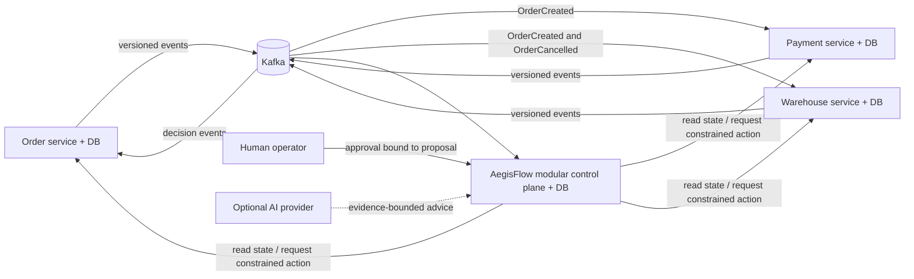

# AegisFlow

> **Status:** P0.2 persistence is complete and verified. P0.3 is now approved and in progress, starting with the isolated persistent-Compose bootstrap rehearsal. Kafka relay/consumer/inbox are not implemented yet. No P0.4, recovery, AI or remote push is authorized.

Final P0.2 host evidence (2026-10-16, source `7a90c57`, completed checkpoint `86452ef`): **full clean reactor BUILD SUCCESS, 38 default tests + 29 real PostgreSQL ITs**, zero failures/errors/skips. All four packaged foundation JARs returned HTTP 200/UP; documentation checks passed. These remain preserved results, not a substitute for P0.3 verification. The current coding session cannot access Docker's engine pipe. See [current handoff](docs/HANDOFF.md) and [test evidence](docs/evidence/TEST_RESULTS.md).

AegisFlow is a learning-oriented, production-minded portfolio project for detecting and safely recovering inconsistent distributed business transactions. The first scenario uses independently persisted Order, Payment, and Warehouse simulators. A control plane will correlate their events, detect breached business invariants, assemble attributable evidence, propose a constrained recovery, require deterministic policy and human approval where appropriate, invoke only versioned service APIs, and verify the result against authoritative service state.

AegisFlow is **not** represented as enterprise-ready software. It is a deliberately bounded system in which failure semantics, security boundaries, tests, and resumable documentation are treated as first-class deliverables.

## The problem in one example

An order is accepted and payment succeeds, but the warehouse times out. A timeout does not reveal whether the reservation failed or succeeded. Retrying blindly can duplicate a side effect; refunding blindly can create a different inconsistency. AegisFlow records the ambiguity, queries the warehouse's authoritative API, applies policy and approval rules to an exact recovery proposal, uses an idempotency key and state precondition when acting, and independently checks the final state before calling the incident resolved.

## Scope and safety boundary

The MVP across product stages P0–P2 is intended to demonstrate:

- at-least-once Kafka event delivery with database-enforced inbox idempotency;
- explicit handling of duplicates, reordering, schema incompatibility, missing events, and ambiguous remote outcomes;
- durable incident, evidence, approval, action-attempt, and verification records;
- tenant-scoped authorization and data access;
- a deterministic investigator before an optional evidence-backed AI investigator;
- recovery through versioned APIs with scoped credentials—never direct writes to simulator databases; and
- a fault-injected, testable vertical slice with honest observed results.

Out of scope for the first implementation are real money movement, real customer data, autonomous financial compensation, a general-purpose workflow engine, Kubernetes, and claims of universal exactly-once effects.

## Proposed system shape



This diagram is the intended product design. The current code adds internal `create` persistence operations and stored outbox envelopes to P0.1's four application shells. Core remains a modular deployment with its own database; simulators stay separate deployables/databases. Each owner's real PostgreSQL suite has passed on the host; this does not demonstrate the future Kafka flow shown above. See [System Architecture](docs/architecture/SYSTEM_ARCHITECTURE.md) and [the handoff](docs/HANDOFF.md).

## Build and run the foundation

Prerequisites: a **Java 21 JDK**, network access on the first build, and a writable Maven cache. The wrapper installs the pinned Maven 3.10.0 distribution; a separate Maven installation is unnecessary. POSIX also requires `unzip` for the checksum-pinned ZIP distribution. The milestone was verified on Windows/PowerShell 7; the POSIX wrapper was not executed.

From the repository root on Windows, replace the JDK path with your own Java 21 installation:

```powershell
$env:JAVA_HOME = 'C:\path\to\your\jdk-21'
.\mvnw.cmd -version
.\mvnw.cmd -B -ntp clean verify
.\scripts\verify-startup.ps1
.\scripts\verify-docs.ps1
```

The scripts require PowerShell 7 on Windows. `verify-startup.ps1` starts all four packaged JARs on temporary ports, checks HTTP health, writes ignored reports under `.cache/startup/`, and stops only its own processes. `verify-docs.ps1` checks documentation consistency.

On POSIX:

```sh
export JAVA_HOME=/path/to/your/jdk-21
./mvnw -version
./mvnw -B -ntp clean verify
"$JAVA_HOME/bin/java" -jar control-plane/target/aegisflow-core-0.1.0-SNAPSHOT.jar --spring.profiles.active=foundation
```

To keep an application running, invoke its JAR in a separate terminal using Java 21. On Windows the Core command is:

```powershell
& "$env:JAVA_HOME\bin\java.exe" -jar control-plane/target/aegisflow-core-0.1.0-SNAPSHOT.jar --spring.profiles.active=foundation
```

| Application | Executable JAR after `verify` | Default health URL |
|---|---|---|
| Core | `control-plane/target/aegisflow-core-0.1.0-SNAPSHOT.jar` | `http://127.0.0.1:8080/actuator/health` |
| Order | `simulators/order-service/target/order-service-0.1.0-SNAPSHOT.jar` | `http://127.0.0.1:8081/actuator/health` |
| Payment | `simulators/payment-service/target/payment-service-0.1.0-SNAPSHOT.jar` | `http://127.0.0.1:8082/actuator/health` |
| Warehouse | `simulators/warehouse-service/target/warehouse-service-0.1.0-SNAPSHOT.jar` | `http://127.0.0.1:8083/actuator/health` |

The default `foundation` profile needs no Docker or database. Health `UP` means the process started, **not** that commerce, authentication, or database behavior works. HTTP binds to loopback and exposes only Actuator health without internal details. Do not expose this unauthenticated foundation publicly.

### PostgreSQL persistence verification

For the approved P0.3-A rehearsal, use `scripts/verify-compose-persistence.ps1` instead of starting the ordinary development project. It reuses this repository's Compose/bootstrap and existing Java 21 JARs, with an isolated `aegisflow-p03-verify-<guid>` project and fresh synthetic credentials. The same built JARs now run in a digest-pinned Java 21 test container, each attached only to its owner's internal database network. A small in-container Java health probe avoids relying on host-published database ports. It checks two startups against the same retained volumes. No existing development volume or private `.env` is changed and no volume is deleted; synthetic verification volumes remain for explicit later cleanup. Its ignored reports are under `.cache/compose-persistence/<project>/`.

From ordinary Windows PowerShell 5.1, enter the existing bundled PowerShell 7 first (avoid nested `-Command` quoting):

```powershell
$ps7 = 'C:\Users\User\.cache\codex-runtimes\codex-primary-runtime\dependencies\native\powershell\pwsh.exe'
& $ps7 -NoProfile
# Run the following INSIDE the new PowerShell 7 prompt, from this repository:
$env:JAVA_HOME = 'C:\Program Files\Eclipse Adoptium\jdk-21.0.12.101-hotspot'
.\scripts\verify-compose-persistence.ps1
```

This is a real Docker/PostgreSQL rehearsal and fails when engine access is unavailable. Its first real host attempt successfully initialized/bootstrapped all four databases, then failed on the old host-port lookup before Java or migrations; that failure is preserved in evidence. Internal-only networking can prevent host port publication, so the repaired runner does not weaken isolation or loosen its port parser. It pulls only the pinned official `eclipse-temurin:21-jre-jammy` verification image, compiles the small probe with the existing host JDK 21, then creates read-only/non-root owner-network application containers with no host ports or Docker socket. Only exactly labeled test application containers are removed; database volumes remain. A full repaired run is still unverified.

For infrastructure-free checks use `scripts/test-compose-persistence.ps1`, `scripts/test-rehearsal-probe.ps1` (requires JDK 21), and `scripts/verify-compose-persistence.ps1 -StaticOnly`; none proves a database or HTTP startup. The override still uses Docker Compose 2.24.4+ [replacement semantics](https://docs.docker.com/reference/compose-file/merge/#replace-value); its declared ephemeral database ports are not needed by the repaired runner. Ordinary Windows-host JDBC access to the base internal-only Compose networks remains an unverified limitation, not a reason to change `internal: true`. No Kafka broker, relay or inbox is introduced until the requested persistence gate is executed and its outcome reviewed.

`compose.yaml` preserves four separately owned PostgreSQL instances, networks, and volumes on loopback ports 5433–5436. Copy `.env.example` to ignored `.env` and privately fill twelve distinct bootstrap/migration/runtime passwords. Existing `*_DB_USER`/`*_DB_PASSWORD` remain administration-only to preserve existing volumes. Normal application connections use `*_DB_RUNTIME_USER`/`*_DB_RUNTIME_PASSWORD`; Flyway uses `*_DB_MIGRATION_USER`/`*_DB_MIGRATION_PASSWORD`. Docker Compose reads `.env`; manually launched Java processes need only their own matching variables explicitly supplied. Never give Core simulator credentials.

```powershell
if (-not (Test-Path .env)) { Copy-Item .env.example .env }
# Fill password values privately, then validate/start local databases:
docker compose --profile postgres config --quiet
docker compose --profile postgres up -d
.\scripts\bootstrap-databases.ps1
# Independent test containers; this script rejects any skipped integration test:
.\scripts\verify-persistence.ps1
.\scripts\verify-startup.ps1
.\scripts\verify-docs.ps1
```

The bootstrap script is repeatable after containers start and does not erase volumes. Flyway requires the pre-provisioned `aegisflow` schema and validates migrations; Hibernate validates rather than creates tables. The default `foundation` profile still starts without infrastructure and registers no persistence services. `postgres` fails if required credentials/database/migrations are unavailable. The direct Maven infrastructure profile explicitly reports unavailable Docker as skipped; the verification script turns any skip into a failed milestone gate. Commands above are reproducible instructions, not an assertion that they passed here. See [ADR 0008](docs/adr/0008-persistence-primitives-and-database-roles.md).

Maven test JVMs explicitly use UTC because PgJDBC sends the JVM timezone during connection startup; some server timezone databases reject the legacy host alias `Asia/Calcutta`. For manual Java launches with `postgres`, put `-Duser.timezone=UTC` before `-jar` (and provide only that application's own DB variables). This leaves Windows timezone unchanged. A later Hibernate/SQL timezone setting cannot repair an already rejected startup handshake.

## Documentation map

| Start here | Purpose |
|---|---|
| [Product requirements](docs/requirements/PRD.md) | users, scope, workflow, requirements, acceptance tests, competitor-aware position |
| [System architecture](docs/architecture/SYSTEM_ARCHITECTURE.md) | containers, modules, trust boundaries, end-to-end flows |
| [Module boundaries](docs/architecture/MODULE_BOUNDARIES.md) | actual P0.1 packages, dependency rules, and tests |
| [Data model](docs/architecture/DATA_MODEL.md) | ownership, durable records, constraints, tenant keys |
| [Event contracts](docs/architecture/EVENT_CONTRACTS.md) | envelope, schemas, ordering, compatibility, topics |
| [Invariants](docs/architecture/INVARIANTS.md) | business rules, deadlines, allowed outcomes |
| [Recovery state machine](docs/architecture/RECOVERY_STATE_MACHINE.md) | incident and action transitions, claims, retries, ambiguity |
| [Threat model](docs/security/THREAT_MODEL.md) | assets, threats, controls, residual risk |
| [Failure matrix](docs/evaluation/FAILURE_MATRIX.md) | required failure injection and assertions |
| [AI evaluation](docs/evaluation/AI_EVALUATION.md) | deterministic baseline, AI rubric, abstention, cost |
| [Phase 0 review](docs/evaluation/PHASE0_REVIEW.md) | reproducible documentation checks and review limits |
| [Test evidence](docs/evidence/TEST_RESULTS.md) | measured P0.1 build, startup, boundary, and skipped infrastructure checks |
| [Implementation plan](docs/roadmap/IMPLEMENTATION_PLAN.md) | phased build plan and exit gates |
| [Roadmap](docs/ROADMAP.md) | prioritized now/next/later view |
| [ADRs](docs/adr/) | architectural decisions and consequences |
| [Open questions](docs/OPEN_QUESTIONS.md) | unresolved decisions with owners and decision deadlines |
| [Known limitations](docs/KNOWN_LIMITATIONS.md) | honest boundaries and unimplemented behavior |
| [Codebase guide](docs/learning/CODEBASE_GUIDE.md) | beginner-oriented map, concepts, exercise, interview Q&A |
| [Development journal](docs/devlog/DEVELOPMENT_JOURNAL.md) | chronological factual work log |
| [Handoff](docs/HANDOFF.md) | exact continuation point and next acceptance criteria |
| [Contributor/agent protocol](AGENTS.md) | mandatory continuity and evidence rules |

## Technology baseline

P0.1 builds on Java 21, Maven Wrapper 3.3.4 selecting Maven 3.10.0, Spring Boot parent 4.1.1, and Spring Modulith BOM 2.1.1. Actual dependency resolution includes Spring Framework 7.0.9, Flyway 12.4.0, PostgreSQL JDBC 42.7.13, JUnit 6.0.3, and Testcontainers 2.0.5. The build rejects non-Java-21 runtimes and direct/transitive dependencies between deployable artifacts.

Kafka, Spring Security/Keycloak, Spring AI 2.0.1, and full OpenTelemetry/Prometheus/Grafana integration remain future phases; they are not dependencies or functioning integrations today. [ADR 0006](docs/adr/0006-technology-baseline-and-version-pinning.md) preserves official compatibility references and the BOM strategy; [test evidence](docs/evidence/TEST_RESULTS.md) records what was actually resolved and executed.

## Verified P0.1 baseline and current P0.2 gate

On 2026-10-12, root `clean verify` passed with **14 tests, zero failures/errors/skips**. A later `verify` also passed all 14 tests with a caller environment selecting `postgres`; test contexts explicitly select `foundation`. Core's four architecture tests verify the ten documented modules, zero allowed cross-module dependencies, and no Core-to-simulator imports. The four independently packaged JARs each returned HTTP 200 and health `UP` in the startup check.

Those results describe the committed P0.1 source, not the new P0.2 source. The owner also reported a Java 21 reactor `clean verify` success on 2026-10-12 at 12:29:48 IST (53.197 seconds). P0.2 has dedicated tests for commit/rollback, unchanged/changed/concurrent requests, tenant foreign keys, optimistic locking, immutable outbox intent, privileges, and PostgreSQL startup. Current commands, observed results, failures, and unexecuted checks are recorded in [TEST_RESULTS.md](docs/evidence/TEST_RESULTS.md). No Kafka fault result or universal exactly-once claim is made.

## Continue the project

1. Read [the handoff](docs/HANDOFF.md), then [the implementation plan](docs/roadmap/IMPLEMENTATION_PLAN.md).
2. Inspect `git status` and the latest local commit before editing.
3. P0.2 is complete. Continue the approved P0.3 checkpoint named in the handoff, beginning with the real isolated Compose rehearsal; do not recreate or rerun P0.2 merely to resume. Kafka comes after this gate, then the existing Core `eventing` inbox. P0.4 remains unapproved.
4. Preserve the milestone protocol in [AGENTS.md](AGENTS.md): tested code, updated explanations, reproducible commands with factual outcomes, devlog/roadmap updates, and a fresh handoff.

The owner reports pushing the completed P0.2 baseline; local `main` now tracks `origin/main` at `86452ef`. New P0.3 commits remain local only. No new push, external deployment, or publication is authorized.
