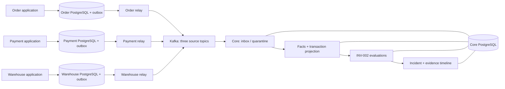

# AegisFlow

A Java backend project that observes distributed business events, detects a missing inventory outcome, and preserves an explainable incident history.

A healthy HTTP endpoint cannot tell you whether an order received the promised Warehouse outcome. AegisFlow demonstrates that distinction: each service owns its state, events may be duplicated or delayed, and a missing observation is not proof that a remote operation failed.

## What works today

P0.1–P0.5 implement service-owned PostgreSQL persistence and transactional outboxes, Kafka delivery, durable validated Core ingestion, tenant-scoped projections, deterministic `INV-002` detection, and persistent incident/evidence timelines. Four Java applications run with four databases and one Kafka broker in the verified local Compose stack.

[Current status and verification scope](docs/STATUS.md) is the authoritative summary. Recovery, AI, frontend, Keycloak integration and full simulator choreography are **not implemented**.

## As-built architecture



Boxes for relays and Core stages are logical components, not additional deployments. Each application connects only to its own database network plus Kafka; Core receives no simulator database credentials. The [architecture guide](docs/architecture/SYSTEM_ARCHITECTURE.md) explains transaction and trust boundaries.

## Event-to-incident flow

1. An owner business operation commits state and its outbox intent in one PostgreSQL transaction.
2. Its relay publishes the original event and records completion only after broker acknowledgement.
3. Core validates source/tenant/schema and commits immutable accepted intake or technical quarantine before acknowledging Kafka.
4. A separate projector transaction commits facts, projection/deadline and progress together.
5. A clock-driven detector evaluates observed inventory evidence. Missing evidence after 45 seconds plus 15 seconds of transport allowance can create one durable incident.
6. Late valid evidence appends a new assessment. `SATISFIED` does **not** erase the incident or imply authoritative `RESOLVED`.

## Technology

Java 21, Maven 3.10.0 via Wrapper, Spring Boot 4.1.1, Spring Modulith 2.1.1, Spring Data JPA/Hibernate and JDBC, Flyway, PostgreSQL 18.6, Kafka broker 4.2.2, and Testcontainers. Versions are repository pins, not recommendations to upgrade. See [ADR 0006](docs/adr/0006-technology-baseline-and-version-pinning.md).

## Local quickstart — Windows PowerShell 7

Prerequisites: Windows 11, Docker Desktop with its Linux engine running, PowerShell 7, Java 21 JDK, and network access for the first dependency/image downloads. Open PowerShell 7 in the repository root. The JDK path below is the verified owner's path; change it for your installation.

```powershell
$env:JAVA_HOME = 'C:\Program Files\Eclipse Adoptium\jdk-21.0.12.101-hotspot'
.\scripts\dev-init.ps1
.\scripts\dev-build-images.ps1
.\scripts\dev-stack.ps1 -Action up
.\scripts\dev-stack.ps1 -Action status
```

For an existing verified installation, skip initialization/build unless needed and use `-Action up` or `status`. The initializer generates and preserves ignored `.env.development`; no manual password copying is required. **Never regenerate credentials when retained volumes depend on them.** A missing file with existing storage fails safely.

Core health is at [localhost:8080/actuator/health](http://127.0.0.1:8080/actuator/health); Order, Payment and Warehouse use 8081–8083. Health is not a business correctness result.

```powershell
# Deliberate new business acceptance run: rebuilds images and briefly restarts the stack.
.\scripts\verify-development-pipeline.ps1

# Application-only restart; non-destructive whole-stack stop.
.\scripts\dev-stack.ps1 -Action restart-apps
.\scripts\dev-stack.ps1 -Action stop
```

The wrapper's `-Action down` also means **stop**, not Docker Compose removal. It preserves containers, networks, volumes and credentials. Read the [complete runbook](docs/LOCAL_DEPLOYMENT.md) for ports, logs, recovery of missing credentials and safe troubleshooting.

## Verification and limits

Final P0.5 acceptance recorded 182 default reactor tests with zero failures/errors/skips, plus real persistent healthy/missing/late-evidence and restart checks. [Evidence and exact provenance](docs/evidence/TEST_RESULTS.md#p05-acceptance-evidence) distinguish this run from earlier integration suites.

This is a production-inspired learning project, not production-certified software. Kafka transport is unencrypted local SASL/PLAIN; the persistent forbidden-write probe is deferred. There is no universal exactly-once guarantee or automatic recovery. See [limitations](docs/KNOWN_LIMITATIONS.md).

## Explore

- [Documentation index and reading paths](docs/README.md)
- [Codebase walkthrough and 90 answered interview questions](docs/learning/CODEBASE_GUIDE.md)
- [Data model](docs/architecture/DATA_MODEL.md), [event contracts](docs/architecture/EVENT_CONTRACTS.md), [module boundaries](docs/architecture/MODULE_BOUNDARIES.md)
- [Threat model](docs/security/THREAT_MODEL.md), [fault scenarios](docs/evaluation/FAILURE_MATRIX.md)
- [Future roadmap](docs/ROADMAP.md), [maintainer handoff](docs/HANDOFF.md), [development history](docs/devlog/DEVELOPMENT_JOURNAL.md)

P1 deterministic recovery and P2 AI/operational surfaces are future, separately approved work.
