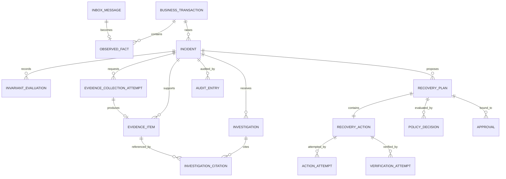

# Data Model

**Status:** P0.2 implemented subset verified on real PostgreSQL at the 2026-10-16 host gate. The logical future model below is preserved. Only the implemented subset in section 0 currently has migrations/code.

**P0.3-B Order-only update, 2026-10-19:** no V1 is modified. `OrderOutboxStore` uses existing publication/lease/fencing columns with one-row SKIP LOCKED claims in separate short transactions. DB time sets expiry/retry/publication; completion requires tenant/outbox/owner/current token/PENDING/live lease. Attempts increase (saturating at integer max), fencing increases per reclaim, completion clears lease fields, and immutable intent is unchanged. All nine relay PostgreSQL tests now pass on the owner's host, including concurrency/fencing and synthetic-publisher ack/crash replay. Actual Kafka relay delivery, other owners and inbox tables remain future work.

## 0. Implemented P0.2 subset

P0.3-A does not modify these migrations or add business/inbox tables. Its isolated Compose-only `scripts/db/persistence-rehearsal.sql` creates a test-harness `p03_rehearsal` schema/sentinel in fresh verification databases; it is not applied to the normal development project. The script compares this committed sentinel and the actual Flyway history after stopping/recreating containers with the same volumes. Actual host execution passed on 2026-10-17: four fresh V1 applications, second-start validation without another migration and unchanged sentinel/full history for all four owners. This operational evidence is distinct from static/helper checks and does not add Kafka/inbox behavior.

Each deployable owns one `aegisflow` schema in its separate PostgreSQL database and its own V1/Flyway history. Core V1 establishes the schema/role boundary only. Order V1 creates `orders`, `order_lines`, `idempotency_record`, `outbox_event`; Payment V1 creates `payments`, `idempotency_record`, `outbox_event`; Warehouse V1 creates `reservations`, `reservation_lines`, `idempotency_record`, `outbox_event`. Exact files are each deployable's `src/main/resources/db/migration/V1__*.sql`.

Composite tenant/resource primary keys and same-tenant foreign keys constrain local references. Cross-service IDs are opaque references with no shared table or cross-database FK. Order now has its own durable create-request replay record, closing the previously unspecified duplicate-submission storage gap. Replay records bind resource/event IDs and a versioned material-request digest; their deferred FKs are validated at commit.

Aggregate UUIDs are assigned explicitly by the caller; event/outbox UUIDs are generated once for a committed operation. Every outbox has tenant/event uniqueness and additional UUID uniqueness within that owner's database. A global cross-database constraint does not exist. `lock_version` is Hibernate's nonnegative optimistic counter; exposed business/event version is counter + 1. Money is exact `numeric(19,4)` plus application-validated ISO currency precision; timestamps are UTC instants in `timestamptz`. [ADR 0008](../adr/0008-persistence-primitives-and-database-roles.md) records tradeoffs and digest rules.

State, line rows where needed, replay result, and complete immutable outbox intent share one local Spring transaction. A constraint/append exception rolls it back. Existing status/attempt/timing/lease/fencing columns now support the opt-in Order relay; Payment/Warehouse workers remain unwritten. Payload/identity updates and deletion remain blocked by runtime privileges and a trigger. Bootstrap administrators, migrators, and runtime users are separate; Flyway never uses the normal runtime DataSource credentials.

Initial internal operations create Order `CREATED`, synthetic Payment `AUTHORIZED`/`DECLINED`, and Warehouse `RESERVED`/`REJECTED` states. Core business tables, all consumer inboxes, Order decisions, Warehouse cancellation markers, incident/recovery/audit behavior, and subsequent state transitions below remain planned. Real PostgreSQL constraint/atomicity/role assertions passed in the final host gate; persistent Compose bootstrap and production behavior are not inferred from those tests. See [test evidence](../evidence/TEST_RESULTS.md).

## 1. Ownership and database boundaries

AegisFlow, Order, Payment, and Warehouse each own a PostgreSQL database (separate database users at minimum; separate instances are optional locally). There are no cross-database foreign keys, shared JPA entities, or control-plane writes to simulator schemas. Cross-service identity is carried through opaque IDs and confirmed through events or versioned APIs.

All tenant-owned primary and unique keys include `tenant_id`. Technical intake quarantine/security signals are separate infrastructure records: malformed input may have no authenticated tenant or transaction and must not be inserted into tenant business tables. UUIDs should be time-sortable only if the selected implementation can generate them safely; correctness must not depend on ordering by UUID. Timestamps are UTC `timestamptz`, stored with millisecond or better precision.

## 2. Control-plane logical model

Every relationship shown is additionally constrained by the same `tenant_id`. An identifier from tenant A can never satisfy a foreign key for tenant B.

## 3. Core records and constraints

### 3.1 Ingestion and correlation

| Record | Essential fields | Required constraints / notes |
|---|---|---|
| `inbox_message` | `tenant_id`, `source_system`, `event_id`, `event_type`, `business_transaction_id`, `schema_version`, `occurred_at`, `received_at`, `correlation_id`, `topic`, `partition`, `offset`, `payload`, `payload_hash`, `payload_hash_version`, `raw_payload_hash`, `status` | PK or unique `(tenant_id, source_system, event_id)`; immutable payload; index `(tenant_id, business_transaction_id, occurred_at)`; conflicting canonical content is quarantined, never overwritten |
| `observed_fact` | `tenant_id`, `fact_id`, `transaction_id`, `source_system`, `source_entity_type`, `source_entity_id`, `source_entity_version`, `fact_type`, `effective_at`, `observed_at`, `inbox_event_id`, `canonical_value` | Unique source event reference; facts are append-only; a retraction is another fact, not an update |
| `business_transaction` | `tenant_id`, `transaction_id`, `transaction_type`, `contract_version`, `first_observed_at`, `last_observed_at`, `derived_status`, `projection_version`, `next_deadline_at` | PK `(tenant_id, transaction_id)`; optimistic `projection_version`; status is derived, not remote authority |
| `quarantine_record` | `quarantine_id`, `channel_identity`, `topic`, `partition`, `offset`, `raw_payload_hash`, nullable `validated_tenant_id`, nullable `claimed_tenant_id`, nullable `claimed_source_system`, nullable `claimed_event_id`, `reason_code`, `received_at`, `raw_payload_location`, `review_status` | Technical unique receipt `(channel_identity, topic, partition, offset, raw_payload_hash)`; claimed fields are untrusted and never select tenant access; security-operator access when no validated tenant exists; no automatic replay |
| `security_signal` | `signal_id`, `quarantine_id`, nullable `validated_tenant_id`, `category`, `severity`, `created_at`, `review_status` | Malformed/source-mismatch/altered-event signals do not require a business transaction/invariant; only validated correlated facts may open a separate business incident |

`inbox_message.status` is `PROCESSED`; `RECEIVED` may exist only transiently inside the valid-event transaction. For a valid new event, inbox insert, observed fact, projection/deadline update, and final `PROCESSED` status commit atomically. A transient processing failure rolls back that unit so redelivery retries it. Invalid/unsupported input commits an isolated technical `quarantine_record` and no trusted inbox/fact/projection change. A conflicting duplicate preserves the original accepted inbox row and quarantines only the conflicting transport receipt.

### 3.2 Detection, evidence, and investigation

| Record | Essential fields | Required constraints / notes |
|---|---|---|
| `invariant_evaluation` | `tenant_id`, `evaluation_id`, `transaction_id`, `invariant_id`, `invariant_version`, `evaluated_at`, `due_at`, `enforce_after`, `result`, `input_fact_ids`, `explanation_code` | `due_at` is trigger time plus business duration; `enforce_after` additionally applies allowed lateness exactly once; append-only inputs are exact fact IDs; result is `SATISFIED`, `VIOLATED`, or `UNKNOWN` |
| `incident` | `tenant_id`, `incident_id`, `transaction_id`, `invariant_id`, `invariant_version`, `dedup_key`, `severity`, `state`, `state_version`, `incident_revision`, `opened_at`, `updated_at`, optional `resolved_at`, `lease_owner`, `lease_until`, `fencing_token` | Unique active `dedup_key`; compare-and-set `state_version` changes on each transition; `incident_revision` changes only for material evidence/decision-context changes and invalidates plans/approvals; fencing token increases on each claim |
| `evidence_collection_attempt` | `tenant_id`, `collection_attempt_id`, `incident_id`, `source_system`, `source_uri_template`, `source_schema_or_api_version`, `subject_type`, `subject_id`, `collector_identity`, `started_at`, `completed_at`, `outcome`, `error_code`, `request_trace_id` | Append-only success/failure/timeout record; bounded endpoint template only (no secrets); a failed attempt may produce no evidence item |
| `evidence_item` | `tenant_id`, `evidence_id`, `incident_id`, `collection_attempt_id`, `kind`, `source_system`, `source_uri`, `source_schema_or_api_version`, `source_entity_id`, `source_entity_version`, `collected_at`, `valid_at`, optional `expires_at`, `collector_identity`, `request_trace_id`, `content_hash`, `redaction_profile`, `content` | Immutable; content hash detects mutation; sensitivity classification and retention required; freshness evaluated against policy; nullable collection attempt only for internally derived event evidence with equivalent provenance |
| `investigation` | `tenant_id`, `investigation_id`, `incident_id`, `method`, `investigator_version`, `prompt_template_version`, optional `model_id`, `started_at`, `completed_at`, `outcome`, `confidence`, `abstained`, `structured_result_hash` | `method` is deterministic or AI-assisted; model result cannot alter incident directly |
| `investigation_citation` | `tenant_id`, `investigation_id`, `evidence_id`, `claim_code`, optional `excerpt_hash` | Composite PK; cited evidence must belong to same incident and tenant |

Evidence provenance answers: who attempted to collect what, with which schema/API version, from which authoritative endpoint/entity/version, at which observation time, with what outcome and trace, and whether the resulting content was transformed or redacted. Event payloads are evidence of a reported transition; current-state API responses are separate evidence and take precedence for recovery preconditions.

### 3.3 Recovery, approval, and verification

| Record | Essential fields | Required constraints / notes |
|---|---|---|
| `recovery_plan` | `tenant_id`, `plan_id`, `incident_id`, `incident_revision`, `plan_revision`, `plan_type`, `created_by_type`, `created_by_id`, `created_at`, `evidence_set_hash`, `plan_digest_schema_version`, `plan_digest`, `status`, optional `execution_id` | Unique `(tenant_id, incident_id, plan_revision)` and `(tenant_id, execution_id)` when allocated; exactly one action per MVP plan; plan digest covers incident revision and typed action content, but evidence/policy are bound separately; first claim atomically allocates execution ID and consumes approval |
| `recovery_action` | `tenant_id`, `action_id`, `plan_id`, `sequence_no`, `target_system`, `action_type`, `api_version`, `parameters`, `precondition`, `postcondition`, `risk_class`, `idempotency_key`, `status`, `state_version`, `lease_owner`, `lease_until`, `fencing_token`, `next_attempt_at` | Unique `(tenant_id, target_system, idempotency_key)`; stable key across attempts; parameters immutable after approval |
| `policy_decision` | `tenant_id`, `policy_decision_id`, `plan_id`, `incident_revision`, `policy_id`, `policy_version`, `policy_hash`, `evaluated_at`, `input_hash`, `decision`, `reason_codes` | Immutable evaluation; decision is `ALLOW`, `DENY`, or `APPROVAL_REQUIRED`; preflight creates a new evaluation ID but compares current policy identity/version/hash and material inputs with the bound evaluation |
| `approval` | `tenant_id`, `approval_id`, `plan_id`, `incident_id`, `incident_revision`, `plan_digest`, `evidence_set_hash`, `policy_decision_id`, `policy_id`, `policy_version`, `policy_hash`, `approved_scope`, `binding_digest_schema_version`, `binding_digest`, `decision`, `actor_id`, `actor_roles`, `decided_at`, `expires_at`, `consumed_at`, `consumed_by_execution_id`, optional `reason` | Exact binding required; first dispatch requires an unconsumed approval; safe retries use its existing execution binding while freshness/expiry remain valid; consumption uses compare-and-set; lifecycle CAS version is deliberately not the bound material revision |
| `action_attempt` | `tenant_id`, `attempt_id`, `action_id`, `attempt_no`, `fencing_token`, `started_at`, `completed_at`, `request_hash`, `remote_request_id`, `http_status`, `outcome`, `error_code`, `response_hash`, `trace_id` | Unique `(tenant_id, action_id, attempt_no)`; outcome includes `UNKNOWN`; response body is stored only if allow-listed/redacted |
| `verification_attempt` | `tenant_id`, `verification_id`, `incident_id`, optional `action_id`, `attempt_no`, `observed_at`, `source_system`, `source_entity_id`, `source_version`, `postcondition`, `result`, `evidence_id`, `trace_id` | Action reference is absent for independently verified self-resolution; result `PROVEN`, `NOT_PROVEN`, or `INCONCLUSIVE`; collector is separate from action result handling |
| `audit_entry` | `tenant_id`, `audit_id`, `occurred_at`, `actor_type`, `actor_id`, `operation`, `entity_type`, `entity_id`, `prior_state`, `new_state`, `reason_code`, `policy_version`, `policy_hash`, `plan_digest`, `trace_id`, `details_hash` | Append-only; indexed by tenant/entity/time; application role has no update/delete permission |

Technical quarantine/security access uses a separate restricted security audit stream because a validated tenant may be absent. It must not fabricate a tenant-owned audit entry from a payload claim.

JSON columns are acceptable for versioned payload snapshots and typed action parameters, but searchable state, tenant keys, versions, lease fields, deadlines, and policy binding fields remain relational columns with constraints. Secrets, bearer tokens, and unredacted payment data are never stored.

`incident.state` is constrained to the canonical values `DETECTED`, `INVESTIGATING`, `NEEDS_REVIEW`, `AWAITING_APPROVAL`, `READY_TO_EXECUTE`, `EXECUTING`, `VERIFYING`, `RESOLVED`, `FAILED`, and `CANCELLED`. Action and attempt statuses use separate enums; in particular, an action may be `OUTCOME_UNKNOWN` while its parent incident is `VERIFYING`. The transition guards are normative in [RECOVERY_STATE_MACHINE.md](RECOVERY_STATE_MACHINE.md).

## 4. Simulator-owned models

All three simulators also own `consumer_inbox(tenant_id, source_system, event_id, payload_hash, processed_at)` with a composite unique key and a local transaction covering inbox, domain changes, and resulting outbox rows. Order retains payment/inventory decision versions; Warehouse retains a cancellation marker so late reservation work cannot resurrect a cancelled order. Each simulator has an `outbox_event` table with the complete columns below, unique `(tenant_id, event_id)`, immutable envelope/hash, and indexes on status/next-attempt time. Claim/lease fields enable bounded relay failover; terminal invalid records use `FAILED` plus an operator-visible reason rather than silently disappearing.

### Order database

- `orders(tenant_id, order_id, business_transaction_id, status, total_amount, currency, version, created_at, updated_at)`
- `order_lines(tenant_id, order_id, line_no, sku, quantity)`
- `order_decisions(tenant_id, order_id, payment_state, payment_version, inventory_state, inventory_version, updated_at)`
- `outbox_event(tenant_id, outbox_id, aggregate_id, aggregate_version, event_id, event_type, envelope, payload_hash, status, created_at, published_at, publish_attempts, next_attempt_at, last_error_code, lease_owner, lease_until, fencing_token)`

### Payment database

- `payments(tenant_id, payment_id, business_transaction_id, order_id, status, amount, currency, provider_reference, version, updated_at)`
- `idempotency_record(tenant_id, operation, idempotency_key, request_hash, result_code, resource_id, resource_version, created_at)`
- `outbox_event(...)`

### Warehouse database

- `reservations(tenant_id, reservation_id, business_transaction_id, order_id, status, version, updated_at)`
- `reservation_lines(tenant_id, reservation_id, line_no, sku, quantity)`
- `cancellation_marker(tenant_id, order_id, order_version, observed_at)`
- `idempotency_record(tenant_id, operation, idempotency_key, request_hash, result_code, resource_id, resource_version, created_at)`
- `outbox_event(...)`

Each aggregate uses an optimistic `version`. Recovery mutation endpoints require an expected version or semantically equivalent precondition. Reusing an idempotency key with a different request hash is a conflict, not a new action.

## 5. Claiming and fencing protocol

1. A worker selects an eligible incident/action whose `lease_until` is absent or expired.
2. In one transaction it conditionally updates `lease_owner`, `lease_until`, `state_version`, and increments `fencing_token`. `SELECT ... FOR UPDATE SKIP LOCKED` may improve throughput but is not the correctness mechanism; the conditional update is.
3. The token is copied to the attempt and, where supported, sent to the target as metadata.
4. Completion updates succeed only when the current owner, token, and expected state version still match.
5. A successor reconciles any prior `UNKNOWN` attempt before invoking the action.

A database clock determines lease expiry to avoid worker clock disagreement. Leases are renewable only while the owner still holds the current token. A lease prevents concurrent orchestration; target-side idempotency prevents duplicate side effects if a stale call nevertheless arrives.

## 6. Retention and data handling

Inbox envelopes, facts, incident history, recovery records, and audit entries need a documented retention period before production-like use. Large/raw evidence should be referenced from protected object storage rather than growing PostgreSQL without limit; its `content_hash` and immutable metadata remain in the database. Deletion must be tenant-scoped and preserve legally/security-required audit data. Phase 0 leaves exact durations open but tests must use deterministic cleanup fixtures.

## 7. Schema acceptance targets

Future migrations and integration tests must prove:

- inserting the same `(tenant, source, eventId)` twice yields one inbox record;
- the same key with a different payload hash is rejected and quarantined;
- cross-tenant foreign-key references fail;
- two workers cannot both acquire the same current fencing token;
- an expired approval or changed plan digest cannot make an action eligible;
- the same target idempotency key with a changed request hash is rejected;
- an incident cannot become `RESOLVED` without a `PROVEN` verification tied to current evidence.

These are planned assertions, not current test results.
