# Recovery State Machine

**Current P0.4-C:** DETECTED creation is implemented, actual PostgreSQL gate pending. No transition from DETECTED is implemented. V5 restricts runtime state mutation; late evaluation context increments incident_revision and appends timeline while state_version remains1. The full canonical transition design below remains future work, not an executed recovery system. Terminal recurrence requires that later authorized workflow/schema, never implicit resolution from an event.

## 1. Separation of concerns

An **incident** tracks the lifecycle of a violated or ambiguous invariant. A **recovery action** tracks one bounded remote mutation. An **action attempt** records an invocation that may have an unknown outcome. Keeping these separate prevents a network response from prematurely closing the incident.

Each MVP plan contains exactly one action. Its execution result follows that action; no parallel steps, partial multi-action success, or automatic compensating chain exists. A second repair requires a separately evaluated plan and approval. Multi-action workflow semantics require a future ADR.

## 2. Incident lifecycle

```mermaid
stateDiagram-v2
    [*] --> DETECTED: invariant violated or ambiguous
    DETECTED --> INVESTIGATING: deduplicated incident; collect evidence
    INVESTIGATING --> NEEDS_REVIEW: evidence ambiguous / abstain / no safe automatic plan
    INVESTIGATING --> VERIFYING: new evidence indicates self-resolution without an action
    INVESTIGATING --> AWAITING_APPROVAL: valid plan requires human approval
    INVESTIGATING --> READY_TO_EXECUTE: policy permits valid plan without approval
    INVESTIGATING --> FAILED: no permitted recovery can satisfy the invariant
    AWAITING_APPROVAL --> READY_TO_EXECUTE: exact plan approved and unexpired
    AWAITING_APPROVAL --> NEEDS_REVIEW: rejected / expired / binding invalidated
    READY_TO_EXECUTE --> INVESTIGATING: evidence or target precondition changed
    READY_TO_EXECUTE --> AWAITING_APPROVAL: current policy requires a new approval
    READY_TO_EXECUTE --> NEEDS_REVIEW: current policy denies or plan is no longer safe
    READY_TO_EXECUTE --> EXECUTING: eligible action claimed
    EXECUTING --> INVESTIGATING: preflight invalid or definitive no-effect precondition rejection
    EXECUTING --> AWAITING_APPROVAL: pre-dispatch policy / binding invalidated
    EXECUTING --> READY_TO_EXECUTE: definitive retryable no-effect rejection
    EXECUTING --> VERIFYING: applied report or outcome unknown
    EXECUTING --> FAILED: definitive non-applied permanent failure
    VERIFYING --> RESOLVED: authoritative postcondition proven
    VERIFYING --> INVESTIGATING: action-less check disproves self-resolution
    VERIFYING --> READY_TO_EXECUTE: proven not applied and safe retry permitted
    VERIFYING --> NEEDS_REVIEW: bounded checks inconclusive / contradictory
    NEEDS_REVIEW --> INVESTIGATING: new evidence or authorized reassessment
    NEEDS_REVIEW --> AWAITING_APPROVAL: reviewed plan requires approval
    DETECTED --> CANCELLED: authorized false-positive / superseded incident
    NEEDS_REVIEW --> CANCELLED: authorized cancellation
    AWAITING_APPROVAL --> CANCELLED: approval explicitly declined and incident cancelled
    READY_TO_EXECUTE --> CANCELLED: authorized cancellation before invocation
    RESOLVED --> [*]
    FAILED --> [*]
    CANCELLED --> [*]
```

The canonical incident states are exactly `DETECTED`, `INVESTIGATING`, `NEEDS_REVIEW`, `AWAITING_APPROVAL`, `READY_TO_EXECUTE`, `EXECUTING`, `VERIFYING`, `RESOLVED`, `FAILED`, and `CANCELLED`. `RESOLVED`, `FAILED`, and `CANCELLED` are terminal for that incident revision. `FAILED` and `CANCELLED` do **not** claim that business state is healthy. New facts open a linked successor incident rather than rewriting terminal history. `NEEDS_REVIEW` stops automation until a human-authorized reassessment or exact plan path is recorded.

## 3. Transition guards

| From → to | Required durable guard | Prohibited shortcut |
|---|---|---|
| `DETECTED → INVESTIGATING` | Unique incident dedup key `(tenant, transaction, invariant, violation episode)`; evidence collection job durably scheduled | Opening duplicate active incidents for redelivery |
| `INVESTIGATING → NEEDS_REVIEW` | Reason code and available provenance recorded; missing/ambiguous evidence identified | Guessing a missing fact or letting an AI answer hide uncertainty |
| `INVESTIGATING → VERIFYING` | New facts indicate an allowed current outcome; schedule a fresh authoritative check without a recovery action | Resolving solely because a late event arrived |
| `INVESTIGATING → READY_TO_EXECUTE` | Typed plan validates; deterministic baseline stored; policy permits risk class without approval; evidence fresh | Letting free-form AI output or confidence grant permission |
| `INVESTIGATING → AWAITING_APPROVAL` | Plan digest, evidence-set hash, policy version, scope, and expiry fixed | Approving an editable plan |
| `AWAITING_APPROVAL → READY_TO_EXECUTE` | Authorized actor; exact unexpired binding; separation-of-duty rule passes | Reusing approval after plan/evidence/policy change |
| `READY_TO_EXECUTE → INVESTIGATING/AWAITING_APPROVAL/NEEDS_REVIEW` | Pre-dispatch recheck detects respectively stale/changed evidence or resource state, a new approval requirement, or a deterministic deny/no-safe-plan result; no remote request was sent | Executing under an obsolete eligibility result |
| `READY_TO_EXECUTE → EXECUTING` | Preconditions fresh; stable idempotency key; successful fenced lease claim; required approval atomically consumed for this plan execution | Two current workers, approval replay, or a per-attempt idempotency key |
| `EXECUTING → INVESTIGATING/AWAITING_APPROVAL` before dispatch | Claimed action has not entered `INVOKING`; preflight detects changed evidence/resource state or policy/binding; attempt/claim is durably closed or released | Using this reverse path after a remote request might have been sent |
| `EXECUTING → INVESTIGATING` after definitive precondition rejection | Target guarantees no effect or pending application and its current version invalidates the plan; release the claim, block the action, and collect new evidence | Retrying with a modified expected version under the old approval/key |
| `EXECUTING → READY_TO_EXECUTE` after definitive rejection | Authenticated target contract guarantees no effect or pending application; rejection is retryable; same action/key, current parent revision/binding, freshness, deadline, and retry budget remain valid | Treating a timeout, `NOT_FOUND`, or an ambiguous error as a definitive rejection |
| `EXECUTING → VERIFYING` | Target reports applied/already applied **or** timeout/disconnect/crash leaves outcome unknown | Treating HTTP `2xx` as incident success or blindly retrying an unknown outcome |
| `VERIFYING → READY_TO_EXECUTE` | Authoritative evidence proves the prior attempt was not applied; same action/key remains safe and retry policy permits | Retrying merely because a check timed out |
| `VERIFYING → NEEDS_REVIEW` | Bounded operation-status and authoritative-state checks remain inconclusive or contradictory | Infinite polling or choosing the most convenient source |
| `VERIFYING → RESOLVED` | Independent authoritative query proves invariant/postcondition at a recorded version | Trusting AegisFlow projection, AI, or command response alone |
| `VERIFYING → INVESTIGATING` without an action | Fresh authoritative check conclusively shows the incident still violated; record the observation and reassess | Using an action-less negative check as authorization to dispatch a recovery |
| `* → CANCELLED` where diagrammed | Authorized reason; no unresolved in-flight/unknown effect; atomically cancel all uninvoked actions and invalidate their claims/eligibility; audit entry | Cancelling `EXECUTING` or unresolved `VERIFYING` work to avoid reconciliation, or leaving a cancelled parent's action claimable |

Every transition uses compare-and-set on `state_version`, writes an audit record in the same local transaction, and verifies the authenticated tenant/actor. Invalid transitions fail closed. A separate `incident_revision` increments only when material evidence or decision context changes. Plans and approvals bind that material revision; expected moves through approval, readiness, execution, and verification increment the CAS version without invalidating their own approval.

## 4. Recovery-action lifecycle

```mermaid
stateDiagram-v2
    [*] --> PLANNED
    PLANNED --> BLOCKED: policy or approval missing
    PLANNED --> ELIGIBLE: policy and bindings valid
    PLANNED --> CANCELLED: authorized before eligibility
    BLOCKED --> ELIGIBLE: exact requirement satisfied
    BLOCKED --> CANCELLED: authorized abandonment
    ELIGIBLE --> BLOCKED: evidence / policy / approval invalidated
    ELIGIBLE --> CANCELLED: authorized before claim
    ELIGIBLE --> CLAIMED: lease + fencing token acquired
    CLAIMED --> BLOCKED: preflight invalid; no remote request sent
    CLAIMED --> INVOKING: precondition rechecked
    INVOKING --> APPLIED_REPORTED: applied / already applied response
    INVOKING --> NOT_APPLIED: definitive safe rejection
    INVOKING --> OUTCOME_UNKNOWN: timeout / disconnect / crash window
    OUTCOME_UNKNOWN --> APPLIED_REPORTED: reconciliation proves applied
    OUTCOME_UNKNOWN --> ELIGIBLE: reconciliation proves not applied and retry allowed
    OUTCOME_UNKNOWN --> RECONCILIATION_INCONCLUSIVE: bounded checks cannot determine
    APPLIED_REPORTED --> VERIFIED: independent postcondition proven
    APPLIED_REPORTED --> RECONCILIATION_INCONCLUSIVE: authoritative postcondition absent / contradictory
    NOT_APPLIED --> ELIGIBLE: retryable and attempts remain
    NOT_APPLIED --> FAILED: permanent or exhausted
    VERIFIED --> [*]
    FAILED --> [*]
    CANCELLED --> [*]
    RECONCILIATION_INCONCLUSIVE --> [*]
```

These are recovery-action states, not incident states. `OUTCOME_UNKNOWN` always places the parent incident in `VERIFYING`; `RECONCILIATION_INCONCLUSIVE` places it in `NEEDS_REVIEW`. The first P1 slice requires human approval for every state-changing recovery. The no-approval edge in the general incident graph is disabled by that policy and reserved for a later explicitly reviewed non-financial risk class. The MVP does not automatically void, refund, capture, or otherwise compensate money.

## 5. Claim, lease, and retry rules

- Eligible work is claimed with one conditional database update that increments a monotonic fencing token and sets a database-clock lease expiry.
- Claim and dispatch also require the parent incident to be `READY_TO_EXECUTE`/`EXECUTING` as appropriate and its plan/revision/binding to remain current. Parent cancellation or plan supersession atomically blocks uninvoked work; an action state alone cannot authorize dispatch.
- A worker can record completion only if its owner ID, token, expected action state, and state version still match. Expiry alone does not let the stale worker finalize.
- The remote request contains the action's stable idempotency key, tenant, expected resource version/precondition, and trace context. Target APIs reject a key reused with a different request hash.
- Retries use bounded exponential backoff with jitter, a maximum attempt count, and an absolute action deadline. Configuration is recorded with the attempt; tests use deterministic jitter/clock substitutes.
- Authentication/token errors trigger credential refresh only when safe. They do not consume evidence freshness indefinitely or change action parameters.
- Rate limits and target unavailability delay execution. Attempt exhaustion escalates; it never converts failure into success.

## 6. Unknown remote outcome protocol

When a request times out, the system cannot know whether the target committed before the connection failed.

1. Persist the action attempt outcome as `UNKNOWN` and the parent recovery action state as `OUTCOME_UNKNOWN`, with request hash, action-level idempotency key, attempt ID, remote request ID if known, timestamps, and trace ID.
2. Transition the parent incident from `EXECUTING` to `VERIFYING` and stop ordinary retries for that action.
3. Query the target's operation-status endpoint by tenant/idempotency key. If unavailable, query authoritative resource state and version using the expected postcondition.
4. If applied is proven, proceed to independent verification. If not applied is proven, the same action and idempotency key may return to `ELIGIBLE` under retry policy.
5. If bounded checks conflict, are stale, or cannot distinguish outcomes, transition the action to `RECONCILIATION_INCONCLUSIVE` and the incident to `NEEDS_REVIEW`; do not issue a compensating guess.

An operation-status `NOT_FOUND` or temporarily absent resource alone does not prove that a delayed in-flight request cannot commit later. The target must provide a definitive non-applied terminal outcome, or the validated same-key idempotency/precondition contract must make a permitted retry safe despite such a late arrival. A different key, forced overwrite, or compensation is never permitted on the strength of absence alone.

The verifier is logically independent: it performs a new read after invocation/reconciliation and records separate evidence. Where eventual consistency exists, it may poll within a bounded verification window before becoming inconclusive.

## 7. Plan, policy, and approval binding

Canonical JSON uses a versioned serializer, sorted object keys, stable array ordering, normalized decimal strings, and UTC instants before hashing:

- `planDigest = SHA-256(canonical(planDigestSchemaVersion, planRevision, tenantId, incidentId, incidentRevision, action[targetSystem, actionType, apiVersion, typedParameters, precondition, postcondition, riskClass]))`.
- `approvalBindingDigest = SHA-256(canonical(bindingDigestSchemaVersion, tenantId, incidentId, incidentRevision, planDigest, evidenceSetHash, policyDecisionId, policyId, policyVersion, policyHash, approvedScope, approverId, decision, decidedAt, expiresAt))`.

At readiness and dispatch, persisted fields are compared as well as the digest; a hash is tamper evidence, not authorization by itself. At first dispatch the approval is consumed once by compare-and-set and bound to the immutable plan execution ID. Retrying that same logical action with its existing action-level idempotency key does not consume a new approval, while a different execution cannot replay it. Any mutation, new material evidence, freshness expiry, tenant/incident revision change, policy identity/version/hash change, or changed resource precondition invalidates eligibility and requires reevaluation/reapproval.

The preflight policy run has its own new evaluation ID for audit. It compares policy identity/version/hash, material input digest, required roles/scopes, and the resulting permission with the originally bound evaluation; it does not require two different evaluations to have the same record ID. Readiness checks the current approver authorization as well as the recorded role snapshot. If a consumed approval expires or is invalidated before a retry, execution stops and a fresh approval must bind the same logical action/key; changing a key never repairs an unknown outcome.

Policy is deterministic, versioned code or declarative rules outside the model. It decides permitted action types, risk class, required roles, maker-checker separation, freshness thresholds, attempt limits, and automatic-versus-human execution. An unavailable policy engine fails closed.

## 8. Failure expectations

| Failure | Required state/result | Never allowed |
|---|---|---|
| Worker crashes before remote call | Lease expires; successor reclaims | Mark applied without attempt evidence |
| Worker crashes after remote success | action `OUTCOME_UNKNOWN`, incident `VERIFYING`; target deduplicates stable key | Fresh business command with new key |
| Two workers race | One current token; loser cannot finalize | Two authoritative side effects |
| Approval expires while queued | Back to approval/policy evaluation | Execute under expired binding |
| Evidence becomes stale | Refresh and regenerate/rebind plan | Execute based on stale precondition |
| Target state version changed | Precondition failure and reinvestigation | Force overwrite |
| AI unavailable or abstains | Deterministic baseline or manual review | Weaken policy or fabricate proposal |
| Verification source unavailable | bounded retries then incident `NEEDS_REVIEW` | Resolve from command response |

## 9. State-machine acceptance targets

Model-based and integration tests must attempt every permitted transition and representative forbidden transitions; race two workers; expire a lease while the first worker is paused; time out before and after simulated target commit; crash after external success; mutate a plan after approval; expire evidence; and return contradictory authoritative state. Assertions cover one external effect, fencing of stale workers, stable idempotency keys, immutable history, and resolution only after proven verification. These are future gates, not observed results.
