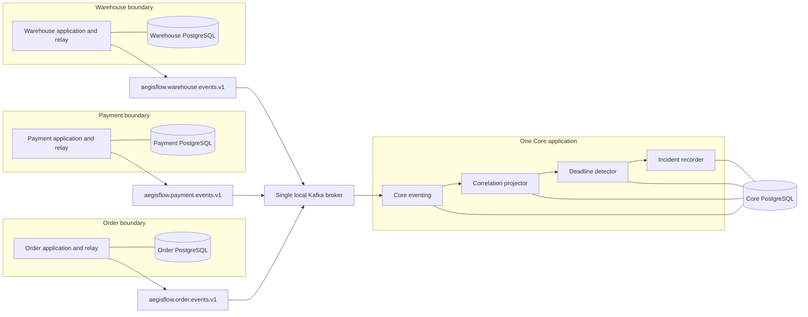
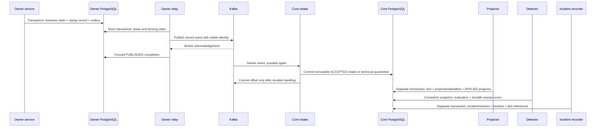

# As-built system architecture

Scope: [verified P0.5](../STATUS.md). AegisFlow observes independent business services; it does not yet repair them. The three simulators are separate deployments and databases because their ownership and failure boundaries are the subject of the demonstration. Core is one modular application because splitting its internal stages into more services would add operational complexity without measured benefit.

## Deployment and data ownership

The topics and internal stages are not extra services. Compose runs four apps, four PostgreSQL instances and one Kafka broker; `kafka-init` is an additional exited provisioning job.

Each app joins its own internal `<owner>-data` network and the shared `kafka-events` network. It receives only its own database migration/runtime and Kafka credentials. Databases do not join the events network; Kafka does not join owner database networks. Host publication is loopback-only. These are local isolation controls, not protection against a privileged host/Docker administrator.

App-to-DB JDBC uses `<owner>-db:5432/aegisflow_<owner>`; container Kafka clients use `kafka:9092`, host clients `127.0.0.1:19092`. [Runbook](../LOCAL_DEPLOYMENT.md) covers actual startup and port mappings.

## Current transaction and acknowledgement sequence

No PostgreSQL transaction spans Kafka publication. A broker acknowledgement followed by failed local completion may produce duplicate delivery with the **same event ID**. No universal exactly-once guarantee follows.

The inbox remains `ACCEPTED`; it is never rewritten to `PROCESSED`. Projection progress is a separate durable table. Pending selection uses an anti-join over accepted identities, so rollback and late-visible commits remain discoverable after Kafka acknowledgement. [ADR 0010](../adr/0010-immutable-inbox-durable-projection.md) supersedes earlier same-transaction intake/projection designs.

## Detection and incident semantics

`CorrelationProjector` rebuilds tenant/transaction projections from immutable facts, source identities and versions rather than cross-topic arrival order. The configured inventory deadline and lateness are pinned to a configuration version.

`DeadlineDetector` uses an injected Java `Clock` and a durable cyclic database scan. It shares the projection gate and checks pending/BLOCKED projection work before a definitive absence judgment. Such unsettled work produces `UNKNOWN`; it is not ignored to manufacture an incident. Network evidence arriving after the consistent snapshot is genuinely later evidence.

`InventoryInvariant` implements only `INV-002`. An on-time matching `InventoryReserved`, or supported matching `InventoryRejected`, can satisfy it. After enforcement, missing/mismatched/contradictory outcomes can violate it; unsupported or ambiguous evidence can remain unknown. See [the decision table](INVARIANTS.md#implemented-inv-002).

`IncidentRecorder` independently discovers eligible immutable evaluations. A unique episode key and timeline completion marker make its transaction recoverable: failure between evaluation commit and incident processing cannot permanently lose the evaluation. Only `VIOLATED` opens an incident. Once open, prior and later matching evaluations enrich its timeline.

P0 implements only `DETECTED`. New on-time evidence delivered late can change the assessment to `SATISFIED`, but does not delete the earlier violation or verify the remote service's current state. [ADR 0012](../adr/0012-durable-incident-timelines.md) explains this distinction.

## Source and tenant trust

Broker ACLs restrict source credentials to source topics. Core maps each topic to a source and explicit allowed-tenant set; producer headers and payload claims alone are not authority. The local demo assumes trusted owner applications/operators. A compromised permitted producer can fabricate facts within its allowlist.

Kafka uses authenticated, unencrypted SASL/PLAIN on a single local broker. Schema/size validation, database uniqueness, immutable history and network separation do not turn this into a public multi-tenant security boundary. [Threat model](../security/THREAT_MODEL.md#current-control-status) distinguishes implemented controls from future obligations.

## Why these technologies

- **Spring Boot / Java 21:** four independently configurable applications, transaction management, JPA/JDBC and executable packaging.
- **PostgreSQL / Flyway:** local atomicity, tenant composite constraints, durable work discovery, explicit roles and independently versioned schemas.
- **Kafka:** asynchronous source-owned event transport and reproducible outage/redelivery boundaries; source topics are not global ordering.
- **Spring Modulith:** verifies Core package dependencies without adding separate process/network boundaries.

See [modules](MODULE_BOUNDARIES.md), [storage](DATA_MODEL.md), and ADRs [0001](../adr/0001-modular-control-plane.md)–[0003](../adr/0003-at-least-once-idempotency.md).

## Planned P1/P2 architecture — not executable

P1 would add authoritative owner APIs, evidence collection, deterministic investigation, constrained proposals, policy/approval, idempotent API dispatch and independent verification. P2 may add advisory AI, an operational UI and telemetry. Keycloak/OIDC and simulator-to-simulator choreography are also not present in the current pipeline.

The proposed [recovery state machine](RECOVERY_STATE_MACHINE.md), [PRD](../requirements/PRD.md) and original full-system diagrams in [reference history](../history/REFERENCE_THROUGH_P05.md) remain design inputs, not implemented behavior. No new stage is authorized by this documentation.
