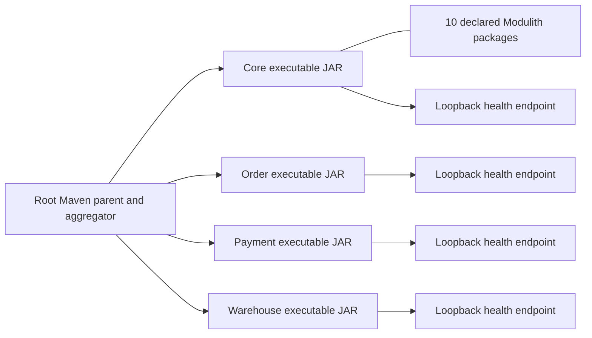
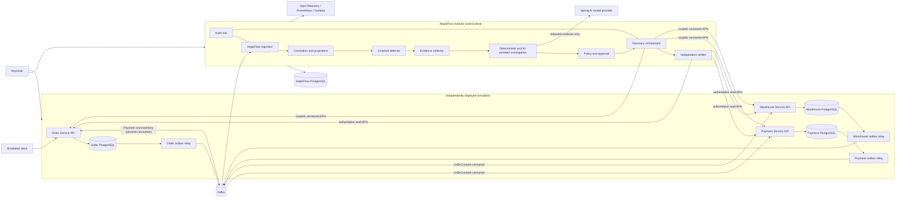

# AegisFlow System Architecture

**Status:** P0.2 and the isolated persistent-Compose gate are verified. P0.3's pinned Kafka Compose setup, listener/credential/topic provisioning and standalone smoke client are implemented; actual broker execution requires the host verification command. Relay/Core inbox remain unimplemented. P0.3 is incomplete; P0.4 is not approved.
**Audience:** implementers, reviewers, and students continuing without the original conversation.

## 1. Purpose and scope

Kafka infrastructure is defined separately in `compose.kafka.yaml`, with the existing project name, its own network and data volume, and no database network attachment. Host clients use authenticated `127.0.0.1:19092`; Docker clients use `kafka:9092`; the authenticated controller listener is unpublished. `scripts/kafka/` provisions source topics/ACLs; `scripts/verify-kafka.ps1` exercises both client routes with `tools/kafka-smoke`. The real broker checks remain pending because this coding session cannot access Docker. [ADR 0009](../adr/0009-local-kafka-listeners-and-source-topics.md) records RF1/seven-day retention, plaintext synthetic-local transport and topic/tenant trust boundaries. No application relay or inbox is connected yet.

The first P0.3-A implementation is operational verification, not new business behavior: `scripts/verify-compose-persistence.ps1` composes the unchanged four PostgreSQL services with `compose.persistence-test.yaml` and reuses the actual bootstrap. The successful 2026-10-17 host run proved eight postgres-profile JAR HTTP health gates, owner runtime/role boundaries and unchanged fixture/full Flyway history across retained-volume restart/repeated bootstrap. The same built JAR runs in a pinned Java 21 container on only its owner's internal network (`owner-db:5432`), with owner-only credentials and in-container loopback HTTP health. No network isolation is weakened; the test application has read-only mounts/root, non-root UID, no added capabilities/host ports/socket and exact-ID/label cleanup. The test-only `p03_rehearsal` fixture/probe are not application business code/migrations. Earlier host-port/health-format failures remain in evidence. The coding session still lacks engine access; host results do not change that permission boundary. Next is Kafka infrastructure, not another persistence rerun.

AegisFlow is a control plane for detecting and safely repairing inconsistent *business transactions*. The first demonstrator models an order that crosses independently persisted Order, Payment, and Warehouse simulators. Each simulator remains the authority for its own state. AegisFlow consumes facts, evaluates explicit invariants, gathers evidence, proposes a bounded recovery, applies deterministic policy and human approval, invokes a versioned service API, and verifies the result from an authoritative read.

This is a production-oriented portfolio architecture, not a claim of production readiness. Phase 0 established the specification; P0.1 now implements only the application foundation below. Unless marked implemented, the diagrams, business flows, durable records, and security controls in this document describe the intended design. Multi-region operation, arbitrary workflow authoring, Kubernetes, Temporal, Redis, pgvector, and automatic financial compensation are outside the MVP unless later evidence justifies them.

### Implemented snapshot — P0.1 (2026-10-12)

The following P0.1 snapshot is historical. Current P0.2 source adds independent V1 migrations, restricted runtime/migration roles, and internal Order/Payment/Warehouse persistence operations. The default foundation still exposes health only. With `postgres`, each simulator has its own JPA entities/repositories and a Spring transaction joining local state, a durable replay result, and immutable outbox intent. Core V1 establishes only its own schema/migration boundary. No application calls a sibling or writes another owner's database. [ADR 0008](../adr/0008-persistence-primitives-and-database-roles.md) and [DATA_MODEL section 0](DATA_MODEL.md) name the implemented subset; the evidence/handoff distinguishes source from executed results.

The current stored flow is `internal typed command → validation/canonical request digest → unique replay claim → owned aggregate/lines → immutable outbox envelope → local commit`. Replays return the original resource/event result; changed material conflicts. An exception rolls the entire unit back. These internal methods have no HTTP ingress yet; authenticated APIs and event consumers will supply trusted tenant context in their approved stages. Outbox rows remain pending until a P0.3 relay exists.



The arrows from Maven describe build organization, not application dependencies or runtime calls. No application currently calls another. Each child owns its POM, main class, configuration, tests, and executable JAR; no child depends on Core or a sibling deployable.

| Concern | Implemented path and behavior | Still planned |
|---|---|---|
| Core bootstrap | `control-plane/src/main/java/com/aegisflow/core/AegisFlowCoreApplication.java`: `@SpringBootApplication`, `@Modulithic`, `SpringApplication.run` | domain services, persistence, event handling |
| Simulator bootstraps | `simulators/{order,payment,warehouse}-service/src/main/java/com/aegisflow/simulator/{order,payment,warehouse}/` with one application class each | independent commerce state and APIs |
| Core boundaries | ten annotated packages, package-private `FoundationModule` markers; [MODULE_BOUNDARIES.md](MODULE_BOUNDARIES.md) names exact packages/tests | narrow interfaces and typed events when behavior requires them |
| Runtime configuration | each child's `src/main/resources/application.yaml`, `application-foundation.yaml`, `application-postgres.yaml` | business migrations and authenticated APIs |
| Health | Actuator health only, loopback defaults 8080–8083; all four standalone JARs checked | database/business/Kafka readiness |
| Infrastructure | `compose.yaml`: four digest-pinned PostgreSQL instances, separate volumes/networks/credentials, loopback ports 5433–5436 | running containers and restricted runtime/migration roles |
| Test gate | 14 default tests passed; Modulith, deployable coupling, Spring contexts, HTTP health; `scripts/verify-startup.ps1` checks packaged JARs | required business/fault/security test suite |

The default `foundation` profile excludes JDBC/Flyway auto-configuration. It is a real Spring Boot process without infrastructure, not a fake database or commerce implementation. The explicit `postgres` profile configures only the application's own database; passwords have no committed default. No business migrations exist. Docker was unavailable, so the optional PostgreSQL Testcontainers check skipped and no database-backed application startup is claimed. The health status `UP` is deliberately a much smaller claim than the product's eventual readiness contract. [ADR 0007](../adr/0007-foundation-profiles-and-stage-boundaries.md) records this milestone boundary; [TEST_RESULTS.md](../evidence/TEST_RESULTS.md) records actual observations.

## 2. Architectural principles

1. **Authority stays local.** AegisFlow never writes a simulator database or treats its own projection as authoritative service state.
2. **Facts before inference.** Immutable event and query evidence is retained with provenance. A conclusion links to the exact evidence used.
3. **Delivery is at least once.** Producer outboxes, Kafka, consumer inboxes, uniqueness constraints, and idempotency keys make repeats safe; “exactly once” is not promised for external effects.
4. **Safety is deterministic.** Code and versioned policy decide what is allowed. AI may explain or propose but cannot approve, execute, or declare success.
5. **Unknown is a real outcome.** A timeout after a remote request is not a failure. The action is reconciled before any retry.
6. **Success requires independent verification.** An HTTP success or emitted event is insufficient; AegisFlow queries authoritative state and records the observation.
7. **Every mutation is tenant-bound, authenticated, auditable, versioned, and resumable.**

## 3. System context and trust boundaries



The ordinary commerce flow uses event choreography. Payment and Warehouse each consume `OrderCreated` in their own consumer group. Each atomically inserts a local inbox receipt, changes its owned aggregate, and adds an outcome to its own outbox. Order consumes both outcome streams, persists the latest valid decisions, and emits `OrderConfirmed` when both succeed or `OrderCancelled` when either fails. Warehouse consumes cancellation, releases an existing reservation, and persists a cancellation marker that makes a later `OrderCreated`/reservation job reject rather than resurrect stock allocation. AegisFlow observes and detects missing outcomes/cleanup. Every simulator consumer has the same database-backed deduplication and acknowledge-after-commit rule as the control plane. A scenario test driver submits an Order API request and configures simulator fault switches; it never writes their databases. AegisFlow does not drive the happy path.

The lines to an AI provider, recovery APIs, identity provider, and Kafka cross explicit trust boundaries. Event `details`, service error bodies, logs, and model output are untrusted data. They never become executable instructions or authorization input without typed validation and deterministic checks.

| Component | Owns | Must not do |
|---|---|---|
| Order simulator | Order lifecycle and order outbox | Read or mutate Payment/Warehouse databases |
| Payment simulator | Payment/authorization lifecycle and payment outbox | Accept an unscoped or non-idempotent recovery mutation |
| Warehouse simulator | Reservation lifecycle and warehouse outbox | Let a network retry create a second reservation |
| AegisFlow | Inbox, projections, incidents, evidence, plans, approvals, executions, verification, audit | Directly mutate simulator data or infer verified success from its projection |
| AI provider | Return a schema-constrained analysis over supplied evidence | Hold action credentials, set policy, grant approval, or call recovery APIs |

## 4. Control-plane module boundaries

The initial control plane is one Spring Boot deployment with Spring Modulith-verified package boundaries and one planned database. P0.1 declares the ten modules but contains no domain methods or repositories and allows no cross-module dependencies. Future modules will communicate through deliberately declared typed application events or narrow interfaces; direct repository access across modules is prohibited. These are build-time architecture checks, not a security sandbox. Exact implementation and enforcement are in [MODULE_BOUNDARIES.md](MODULE_BOUNDARIES.md).

| Module | Planned responsibility | Planned durable records (none implemented in P0.1) |
|---|---|---|
| `eventing` | Validate envelopes, persist inbox records, quarantine invalid/conflicting input | inbox message, quarantine record |
| `correlation` | Build tenant-scoped transaction timelines and derived projections | business transaction, observed fact |
| `detection` | Evaluate versioned invariants and deadlines; open/deduplicate incidents | invariant evaluation, incident |
| `evidence` | Query authoritative APIs and snapshot redacted, provenance-rich evidence | evidence item, collection attempt |
| `investigation` | Run deterministic baseline; optionally request and validate AI analysis | investigation, cited evidence links |
| `recovery` | Build typed plans, evaluate policy, bind approval, lease work, invoke APIs | plan, action, approval, execution attempt |
| `verification` | Independently query authoritative state and close or escalate incidents | verification attempt |
| `identity` | Resolve tenant, actor, scopes, and service principals | security audit references |
| `audit` | Append security- and business-significant transitions | append-only audit entry |
| `operations` | Health, metrics, tracing, operational read APIs | no business authority |

Splitting these modules into services is deferred until measurements reveal an isolation or scaling need. The three simulators are separate deployments and datastores from day one because their independence is the failure boundary the project is intended to study.

## 5. Primary end-to-end flow

```mermaid
sequenceDiagram
    autonumber
    participant S as Authoritative simulator
    participant O as Simulator outbox
    participant K as Kafka
    participant I as AegisFlow inbox
    participant D as Detector
    participant E as Evidence collector
    participant P as Policy / approval
    participant R as Recovery worker
    participant V as Verifier

    S->>S: Commit business state + outbox row atomically
    O->>K: Publish versioned event
    K-->>I: Deliver one or more times
    I->>I: Insert by (tenantId, sourceSystem, eventId)
    I->>D: Process a newly inserted event
    D->>D: Correlate and evaluate invariant/deadline
    D->>E: Open/deduplicate incident and request evidence
    E->>S: Read authoritative state with scoped credential
    S-->>E: State + resource version + observation time
    E->>P: Persist immutable evidence and typed proposal
    P->>P: Deterministic policy; obtain bound approval if required
    P->>R: Make eligible action available
    R->>R: Claim with lease + fencing token
    R->>S: Invoke action with stable idempotency key and precondition
    S-->>R: Applied / rejected / timeout
    R->>V: Request independent verification
    V->>S: Query current authoritative state
    S-->>V: Current state + resource version
    V->>V: Resolve only if postcondition is proven
```

An event can arrive late, more than once, or in a different order from another source. Therefore detection operates over accumulated facts plus deadlines, not consumer arrival order. `occurredAt` is evidence about business time; ingestion time is recorded separately and is used to reason about lateness.

## 6. Durability, concurrency, and failure semantics

- A simulator writes its business change and outbox record in one local database transaction. A relay retries Kafka publication until acknowledged. This closes the “database committed but publish failed” gap without a distributed transaction.
- For a valid event, AegisFlow inserts the inbox row, appends the observed fact, updates the tenant-scoped projection/deadline, and marks the inbox row `PROCESSED` in one local transaction. A composite unique constraint suppresses redelivery; a reused event ID with different canonical content is quarantined in a separate fail-closed transaction and raises a technical security signal. Malformed input needs no business transaction or claimed tenant to enter restricted technical quarantine. Kafka offset acknowledgement follows the applicable durable transaction.
- State transitions use optimistic versions. Worker claims use a bounded lease, monotonically increasing fencing token, and compare-and-set update. An expired worker cannot commit a result with an old token.
- A stable action idempotency key is allocated when the plan action is created, not per attempt. The target stores and returns the first terminal result for that tenant/key.
- If a worker crashes after an external success, its successor first queries by idempotency key or authoritative resource state. It does not issue a fresh business action.
- A remote timeout produces action outcome `OUTCOME_UNKNOWN` and moves the incident to `VERIFYING`. Retries are prohibited until reconciliation proves “not applied”; if bounded checks cannot provide decisive evidence, the incident moves to `NEEDS_REVIEW`.
- Kafka or AI unavailability delays work but cannot bypass policy. Ingestion, deadline scanning, and deterministic investigation resume from durable state.

Detailed states and guards are in [RECOVERY_STATE_MACHINE.md](RECOVERY_STATE_MACHINE.md); storage constraints are in [DATA_MODEL.md](DATA_MODEL.md).

## 7. Tenant and security model

For HTTP requests and producer/gateway submissions, supplied tenant IDs are accepted only within the validated principal's allowed tenant set. Kafka consumption follows the source-topic binding and trusted-producer application contract in EVENT_CONTRACTS.md; a claimed producer header is not an authenticated principal. All business tables carry `tenant_id`; uniqueness and foreign keys include it, repository APIs require it, and Kafka keys begin with it. No cross-tenant correlation, evidence citation, cache key, metric label containing a business identifier, or recovery call is permitted.

Keycloak supplies user and workload identities. AegisFlow uses separate least-privilege credentials for read-state and action APIs; financial scopes are not granted to an automatic worker in the MVP. Authorization is checked again at the application service that performs each transition. PostgreSQL row-level security is an optional additional defense to evaluate under OQ-11; mandatory application checks and tenant-aware database constraints apply regardless.

Evidence sent to an AI provider is allow-listed, minimized, redacted, size-limited, and delimited as data. The response must match a typed schema, cite evidence IDs, state uncertainty, and may abstain. Prompt text, logs, events, and model output cannot select tools, relax policies, or change tenant scope. See [ADR 0005](../adr/0005-ai-advisory-boundary.md).

## 8. Observability and audit

OpenTelemetry trace context propagates through HTTP, Kafka headers, and recovery calls; it is separate from the business `correlationId`. Metrics use bounded labels and include inbox lag, quarantines, incident age, lease contention, retries, unknown outcomes, approval latency, verification result, and policy denials. Logs never contain secrets or raw sensitive evidence.

Audit entries record actor/service identity, tenant, command, prior and next state, policy version, plan digest, approval reference, evidence IDs, action idempotency key, fencing token, and trace ID. Audit append success is part of each local state-transition transaction. Audit data proves what AegisFlow attempted; authoritative query evidence proves business state.

## 9. Phase boundaries and deployment assumptions

- **P0 functional slice:** one control-plane process, three simulator processes, four PostgreSQL databases (one per owner), Kafka, deterministic detection, one injected failure, and automated integration tests.
- **P1 recovery:** typed safe action(s), state preconditions, human approval where policy requires it, timeout reconciliation, independent verification, and concurrent-worker tests. No automatic financial compensation.
- **P2 intelligence/operations:** evidence-backed AI comparison against deterministic baseline, dashboard, and complete observability.
- **P3 optional expansion:** more integrations or orchestration infrastructure only after measured need.

The build-proven foundation is Java 21, Maven 3.10.0, Spring Boot 4.1.1, and Spring Modulith 2.1.1. Actual Maven dependency resolution, compilation, tests, and standalone Spring application startup have run. P0.2's final 2026-10-16 host gate passed 38 default tests and 29 real PostgreSQL ITs with zero skips, then all four packaged foundation startup checks. Earlier skipped PostgreSQL results are preserved as historical evidence; persistent Compose bootstrap is still unexecuted. Kafka is not introduced until approved P0.3. Spring AI 2.0.1 is a documentation-verified P2 candidate only, not a present dependency or proven integration. [ADR 0006](../adr/0006-technology-baseline-and-version-pinning.md) preserves official baseline references; [ADR 0007](../adr/0007-foundation-profiles-and-stage-boundaries.md) makes the staged integration gates explicit.

## 10. Traceability map

| Concern | Normative document |
|---|---|
| Entity ownership, keys, claims, and provenance | [DATA_MODEL.md](DATA_MODEL.md) |
| Envelope, schemas, ordering, and compatibility | [EVENT_CONTRACTS.md](EVENT_CONTRACTS.md) |
| Incident/action transitions and timeout handling | [RECOVERY_STATE_MACHINE.md](RECOVERY_STATE_MACHINE.md) |
| Business deadlines and safety properties | [INVARIANTS.md](INVARIANTS.md) |
| Why the control plane is modular | [ADR 0001](../adr/0001-modular-control-plane.md) |
| Why producers use a transactional outbox | [ADR 0002](../adr/0002-transactional-outbox.md) |
| Why delivery is at least once | [ADR 0003](../adr/0003-at-least-once-idempotency.md) |
| Why all repair is API-mediated | [ADR 0004](../adr/0004-api-mediated-recovery.md) |
| Why AI is advisory | [ADR 0005](../adr/0005-ai-advisory-boundary.md) |
| Current package boundaries and tests | [MODULE_BOUNDARIES.md](MODULE_BOUNDARIES.md) |
| Why startup can run without infrastructure | [ADR 0007](../adr/0007-foundation-profiles-and-stage-boundaries.md) |

## 11. Architecture acceptance checks

Before P0 exits, tests must demonstrate that a committed simulator change is eventually published after relay restart; duplicate delivery creates one inbox fact; out-of-order facts converge to the same projection; a missed deadline opens one tenant-scoped incident; and no AegisFlow database credential can access simulator databases. These are future acceptance targets, not observed results.

P0.1's narrower exit checks cover successful Java 21 builds, independently packaged/runnable applications, ten verified Core modules, default HTTP health, and reproducible evidence. Completing that gate does not complete the product P0 detection slice or authorize P0.2.
